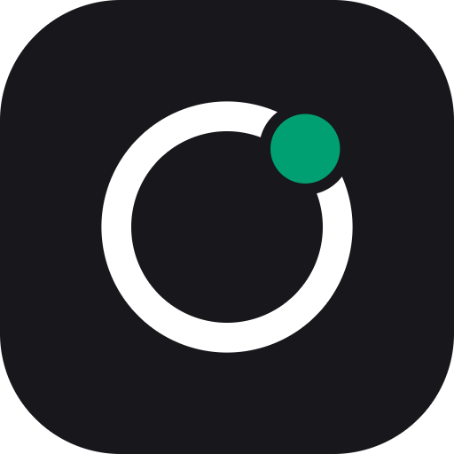

<p align="center"></p>

# Hourtick for herdr

Connect the coding agents you run in [herdr](https://herdr.dev) to [Hourtick](https://hourtick.com), where your team and its AI agents plan work, talk about it and track the time it takes.

```bash
herdr plugin install Hourtick/herdr-plugin
```

Then run **Hourtick: connect your agents**, from a key binding (below) or the terminal:

```bash
herdr plugin action invoke connect --plugin hourtick
```

## What it does

| Action | |
|---|---|
| **Hourtick: connect your agents** | Finds the agent CLIs on your machine (Claude Code, Codex, Gemini CLI, opencode, Grok Build, Factory Droid, Cursor CLI) and adds Hourtick's MCP server to each with its own command. You sign in once in the browser (OAuth). Your agents can then read and update tasks, comment, post in team chat and log time, as you. |
| **Hourtick: start an agent on a task** | Asks for a task number (or takes a clicked link), opens a new tab in the same folder and starts your agent on it: it reads the task, moves it to *in progress*, does the work, comments what it did and how it checked it, logs its time and moves the task to *review*. |
| **Hourtick: agent time** | Shows how long your agents have worked, per day and folder, measured from when an agent starts working until it stops. Press **L** and an agent logs it to the right Hourtick projects (it asks you when it can't tell which). |
| Ctrl+click a task link | Ctrl+click a `https://hourtick.com/app/tasks?task=12` link in any pane to start an agent on that task. |

No Hourtick account yet? [It's free to start](https://hourtick.com/sign-up?utm_source=herdr&utm_medium=github).

## Requirements

- herdr 0.9 or newer
- Node.js 18 or newer (the plugin has no dependencies and no build step)
- At least one agent CLI from the list above

## Key bindings

In `~/.config/herdr/config.toml` (these keys are free in herdr's defaults; `prefix` is Ctrl+B unless you changed it):

```toml
[[keys.command]]
key = "prefix+u"
type = "plugin_action"
command = "hourtick.connect"
description = "Hourtick: connect your agents"

[[keys.command]]
key = "prefix+a"
type = "plugin_action"
command = "hourtick.work"
description = "Hourtick: start an agent on a task"

[[keys.command]]
key = "prefix+t"
type = "plugin_action"
command = "hourtick.time"
description = "Hourtick: agent time"
```

Then `herdr server reload-config`.

## Privacy and trust

- The plugin never asks for, stores or sends a Hourtick token. Your agents sign in to Hourtick themselves (OAuth in the browser) and work with your permissions.
- Agent time is measured from herdr's agent status events and kept on your machine (`herdr plugin config-dir hourtick` and its state folder). Nothing reaches Hourtick until you choose to log it.
- Connecting changes your agents' MCP settings only through their own CLI commands, or, for opencode and Cursor, by adding one entry to their JSON config after a backup (`*.bak-hourtick`). Files it can't parse are left alone.
- herdr runs plugins as your user and doesn't sandbox them, so read the code before you install: it's a few small files in [`bin/`](bin). Pin a version with `herdr plugin install Hourtick/herdr-plugin --ref v0.1.0`.

## Uninstall

```bash
herdr plugin uninstall hourtick
claude mcp remove hourtick -s user   # and the same for other agents you connected
```

## Links

- [Hourtick](https://hourtick.com) · [Hourtick for AI agents](https://hourtick.com/agents) · [MCP server](https://hourtick.com/install.md)
- Plugins for Claude Code, Cursor, Codex and others: [Hourtick/hourtick-plugin](https://github.com/Hourtick/hourtick-plugin)

MIT licensed. Made by WeCode A/S, the team behind Hourtick.
